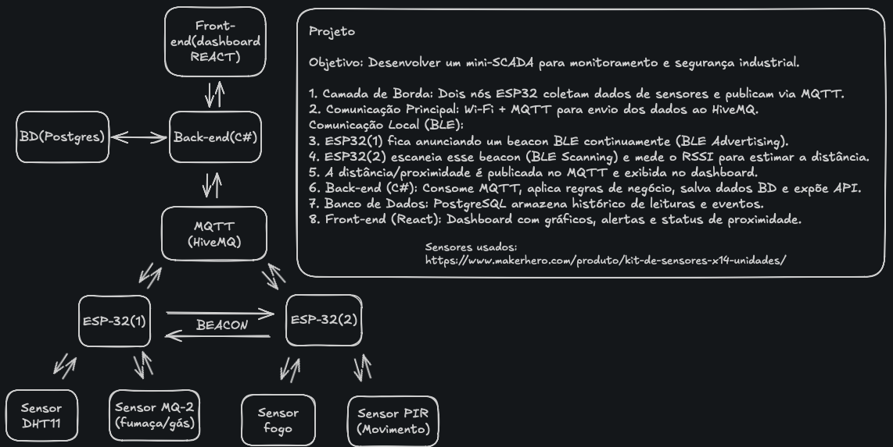

# Mini-SCADA: Environmental Monitoring & Industrial Security

A hands-on SCADA system built to monitor environmental and security variables using edge computing nodes, hybrid wireless communication (Wi-Fi + BLE), and a microservices-based architecture.

https://excalidraw.com/#json=7MxB5bgp4B2l5l_7z1FUg,JZbXQmJDQOgfLpwPagWrbg



## 🎯 Goal
Build a complete hardware-and-software system to monitor, control, and log industrial process data, integrating physical sensors, MQTT/BLE communication, and a real-time supervisory dashboard.

## 🏗️ Architecture & Communication

### Edge Layer (Sensors)
*   **Node 1 - ESP32 (Environment):** Reads a DHT11 sensor (temperature/humidity) and an MQ-2 sensor (smoke/flammable gas). Publishes data over Wi-Fi using the **MQTT** protocol. Also acts as a continuous BLE transmitter (**BLE Advertising / Beacon**).
*   **Node 2 - ESP32 (Security):** Reads a fire/flame sensor and a PIR motion sensor. Operates as a **BLE Scanner**, measuring Node 1's RSSI signal to estimate the distance (proximity) between the two nodes. Publishes its own sensor readings and the beacon data via MQTT.

### Messaging Layer
*   **MQTT Broker (HiveMQ / Mosquitto):** Central router that receives topics from the ESP32 nodes and distributes them to subscribed services.

### Backend & Data Layer
*   **Backend (C# .NET):** Worker/API that subscribes to MQTT topics, processes messages, applies automation business rules, and exposes endpoints for the frontend.
*   **Database (PostgreSQL):** Persists the historical readings (time series) and the event/alert log.

### Supervisory Layer
*   **Frontend (React):** Interactive dashboard that consumes the backend API to display charts, proximity status, and critical security alerts.

## 🚀 Tech Stack
*   **Embedded:** C/C++ (ESP32), BLE (Bluetooth Low Energy)
*   **Messaging:** MQTT (HiveMQ)
*   **Backend:** Node.js/NestJS, C# .NET
*   **Frontend:** React.js / Next.js
*   **Database:** PostgreSQL

## 🛠️ How to Run

### Prerequisites
*   Docker and Docker Compose (for PostgreSQL + the MQTT broker)
*   Node.js 18+ and npm
*   [PlatformIO](https://platformio.org/) (CLI or VSCode extension) to build/flash the ESP32 firmware
*   Two ESP32 boards wired up per [embedded/README.MD](./embedded/README.MD), or a plain MQTT client if you just want to feed it fake data

### 1. Start the infrastructure (PostgreSQL + MQTT broker)
```bash
cd docker
docker compose up -d
```

### 2. Run the backend (NestJS)
```bash
cd nest-node
npm install
cp .env.example .env   # adjust MQTT/DB settings if needed
npm run start:dev
```

### 3. Run the frontend (Next.js)
```bash
cd frontend
npm install
npm run dev
```
Open [http://localhost:3000](http://localhost:3000) to see the dashboard.

### 4. Flash the ESP32 nodes
```bash
cd embedded
pio run -e ambiente -t upload    # environment node
pio run -e seguranca -t upload   # security node
```
See [embedded/README.MD](./embedded/README.MD) for wiring, PlatformIO setup, and per-board build instructions.

## 🗺️ Roadmap / Known gaps
*   [ ] Mobile app (see [mobile/README.MD](./mobile/README.MD)) — not started yet
*   [ ] Historical charts/reporting on the dashboard
*   [ ] Alerting (push/email) on critical sensor events
*   [ ] Automated tests for the MQTT ingestion pipeline
