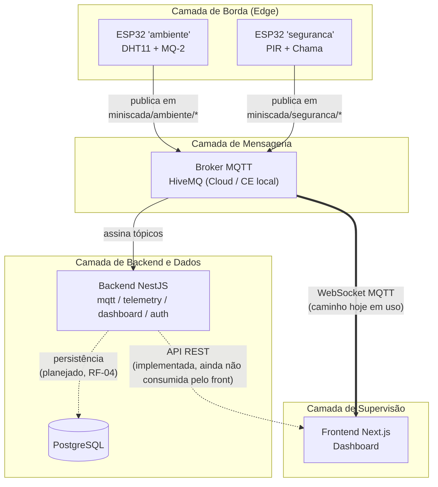
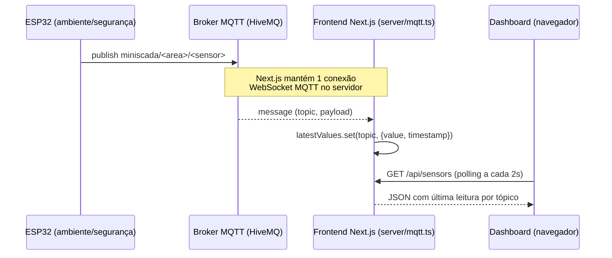
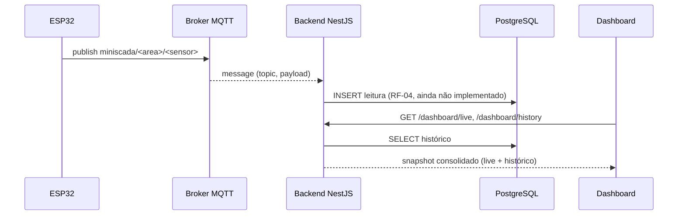

# Arquitetura da Solução

## Visão em camadas

> As linhas tracejadas marcam integrações que existem como código mas ainda não estão no caminho real de dados (ver [`decisoes-arquiteturais.md`](./decisoes-arquiteturais.md#adr-005) para a discussão dessa duplicação).

## Componentes e responsabilidades

### Camada de Borda — nós ESP32

Dois nós especializados, cada um um `environment` PlatformIO independente compilado a partir do mesmo repositório de firmware (ver [`04-Solucao/embarcado.md`](../04-Solucao/embarcado.md)):

- **Nó `ambiente`:** lê temperatura/umidade (DHT11) e nível de gás (MQ-2), publica em `miniscada/ambiente/temperatura`, `miniscada/ambiente/umidade`, `miniscada/ambiente/gas`.
- **Nó `seguranca`:** lê movimento (PIR) e chama (sensor de fogo), publica em `miniscada/seguranca/movimento`, `miniscada/seguranca/fogo`.

Cada nó conecta via Wi-Fi e publica via MQTT sobre TLS diretamente para um broker acessível pela internet — não há gateway/hub local intermediário.

### Camada de Mensageria — Broker MQTT

Ponto único de desacoplamento entre produtores (nós ESP32) e consumidores (backend, frontend). Dois modos de operação coexistem no repositório:

- **HiveMQ Cloud** (gerenciado) — usado pelos nós de campo reais, que precisam de um broker acessível pela internet pública.
- **HiveMQ CE local** (via `docker/docker-compose.yml`) — usado em desenvolvimento, junto com o PostgreSQL local.

### Camada de Backend e Dados

- **Backend NestJS** (`nest-node/`) — módulos `mqtt` (cliente MQTT + cache das últimas mensagens em memória), `telemetry` (endpoint de ingestão HTTP), `dashboard` (agregação para exibição) e `auth` (guard + entidade de usuário). Ver detalhamento de status por módulo em [`04-Solucao/backend.md`](../04-Solucao/backend.md).
- **PostgreSQL** — configurado via TypeORM, mas hoje só tem a entidade `UserEntity` modelada; a entidade de telemetria/histórico ainda não existe (RF-04 é ⚪ planejado).
- **Backend `.NET`** (`backend/`) — presente no repositório como *spike* técnico inicial, ainda no estado de scaffold padrão (`WeatherForecast`). Não faz parte do caminho de dados atual — ver ADR-003.

### Camada de Supervisão

- **Frontend Next.js** (`frontend/`) — hoje conecta **diretamente ao broker MQTT via WebSocket** (`frontend/src/app/server/mqtt.ts`) para alimentar o dashboard, em vez de consumir a API do backend NestJS. Essa é uma decisão registrada e discutida (não um esquecimento) em [`decisoes-arquiteturais.md`](./decisoes-arquiteturais.md#adr-005).

## Fluxo de dados de ponta a ponta (caminho em uso hoje)

## Fluxo planejado (quando o backend for a fonte de verdade)

## Modelo de dados (planejado para RF-04/RF-05)

Não existe hoje uma tabela de telemetria — o desenho abaixo é a proposta natural dado o que já existe (`UserEntity`, `CreateTelemetryDto`), registrada para deixar claro qual seria o próximo passo de arquitetura de dados:

| Tabela | Campos-chave | Observação |
|---|---|---|
| `telemetry_readings` (proposta) | `id`, `device_id`, `topic`, `value`, `received_at` | Uma linha por leitura recebida via MQTT; índice por `(device_id, received_at)` para consultas de histórico |
| `users` (existente) | `id`, `email`, `password_hash`, `name`, `is_active` | Já modelada em `UserEntity`; falta o fluxo de autenticação que a usa de fato (RF-08) |

## Visão de implantação

| Ambiente | Onde roda | Como sobe |
|---|---|---|
| Desenvolvimento local | Docker Desktop (dev machine) | `docker compose -f docker/docker-compose.yml up` (Postgres + HiveMQ CE) + `npm run start:dev` (nest-node) + `npm run dev` (frontend) |
| Nós de campo | ESP32 físico | PlatformIO (`pio run -e ambiente -t upload`) |
| Broker de produção (nós reais) | HiveMQ Cloud (gerenciado) | Fora do repositório — serviço de terceiros |

Detalhes de execução em [`04-Solucao/infraestrutura.md`](../04-Solucao/infraestrutura.md).
