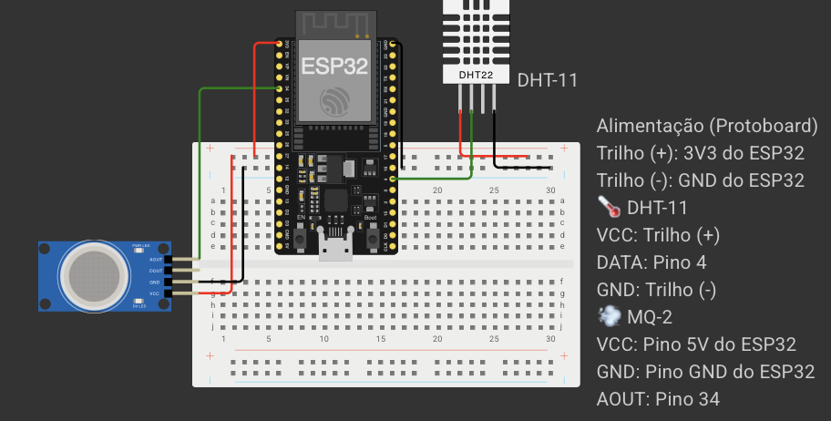
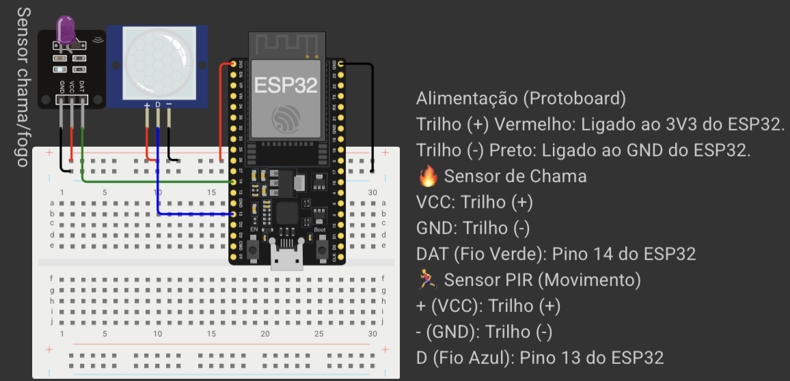

# ESP-32 PROJECT: MQTT, WIFI, BLE (BEACON)

## ESP-32 Environment Monitoring Assembly


## ESP-32 Security Monitoring Assembly


## Project structure

This repository holds the firmware for **multiple ESP32 boards** inside the same PlatformIO project. Each board is a separate *environment* in [platformio.ini](./platformio.ini):

- `ambiente` → code in [src/esp32-ambiente/ambiente/](./src/esp32-ambiente/ambiente/)
- `seguranca` → code in [src/esp32-seguranca/seguranca/](./src/esp32-seguranca/seguranca/)
- `src/shared/` → shared code, compiled by every environment

To add a new board: create `src/esp32-<name>/<name>/<name>.cpp` and an `[env:<name>]` block in `platformio.ini` (you only need to declare what differs from the base `[env]` — platform, board, and common libs are inherited already).

## Wi-Fi / MQTT credentials (`secrets.h`)

`src/shared/NetworkManager.h` expects a `secrets.h` file that is **not** committed to the repo (see `.gitignore`). Create `src/shared/secrets.h` with:

```cpp
#define SECRET_SSID_WIFI "your-wifi-ssid"
#define SECRET_PASS_WIFI "your-wifi-password"
#define SECRET_SSID_MQTT "your-mqtt-username"
#define SECRET_PASS_MQTT "your-mqtt-password"
#define SECRET_MQTT_SERVER "your-mqtt-broker-host"
#define SECRET_MQTT_PORT 1883
```

## How to build/flash a single ESP32

By default, PlatformIO builds **all** environments in `platformio.ini` when you use the VSCode status bar buttons or run `pio run` without flags — regardless of which `.cpp` file is open in the editor. To build/flash just one board, always specify the environment with `-e`:

```bash
pio run -e ambiente                  # build only
pio run -e ambiente -t upload        # build and flash
pio run -e ambiente -t upload -t monitor   # flash and open the serial monitor
pio run -e seguranca -t upload

pio device list                      # list connected serial ports
pio run -e ambiente -t upload --upload-port /dev/cu.usbserial-XXXX  # useful with 2+ ESP32s plugged in at the same time
```

VSCode alternative: use the environment selector in the status bar (bottom, next to the Build/Upload icons) to switch between `ambiente` and `seguranca` before clicking the buttons.

## Installing the PlatformIO CLI (`pio`) in your terminal

The PlatformIO VSCode extension already installs `pio` inside its own isolated Python environment (`penv`), but it isn't available in the terminal by default. To use `pio run`, `pio device list`, etc. outside of VSCode, add `penv` to your `PATH`:

### macOS / Linux

Add this to the end of `~/.zshrc` (or `~/.bashrc` if you use bash):

```bash
export PATH="$HOME/.platformio/penv/bin:$PATH"
```

Then reload the shell:

```bash
source ~/.zshrc
```

Confirm with `pio --version`.

### Windows

**PowerShell** — add this to your profile (`notepad $PROFILE` to edit it):

```powershell
$env:Path += ";$env:USERPROFILE\.platformio\penv\Scripts"
```

Or, to persist it permanently (not just for the current session), via the Windows control panel:

1. Search for "Environment variables" in the Start menu → "Edit the system environment variables"
2. Under "User variables", select `Path` → "Edit" → "New"
3. Add: `%USERPROFILE%\.platformio\penv\Scripts`
4. Reopen the terminal and confirm with `pio --version`

If PlatformIO was installed somewhere else (e.g. via a global `pip install platformio`, without going through the extension), the executable may already be on your `PATH` automatically — in that case `pio --version` just works with none of the steps above.